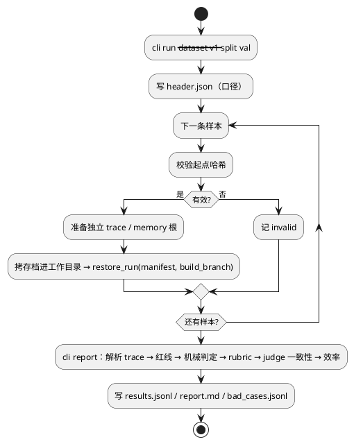
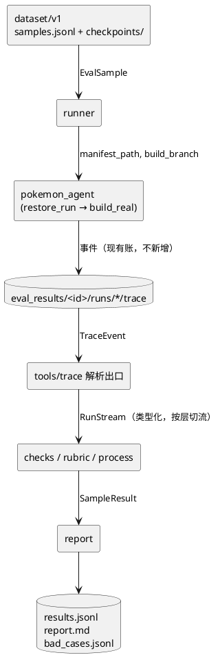

# spec —— 测评体系 v1（run 入口单目标样本 + judge 过程集 + 读侧解析层）

> 流程位置：intent.md → **spec.md** → plan.md → PR → production
> 状态：**已定稿（09-25 晚）**：起点改为 run_begin 存档、真值表按实际来源重写、rubric 改打分、W1～W4 全部拍板 → 下一步写 `docs/eval/plan.md`
> 依据：`docs/eval/intent.md`（09-25 重新设计版，V1/V2/V5/V7/V9～V12 已定）
> 本期目标等级（intent V12）：观测 L3 ｜ 测评集 L2 ｜ 标准 L2 ｜ 门禁 L1 ｜ 归因 L1

---

## 〇、实现与本文的偏差（09-25 实现后补记，以代码为准）

- **起点冻结的是源、不是存档**（改 §三 / §四 / §五 / W3）：存档清单带 `state_schema_hash`，`RunState` 一改旧存档即拒载。
  所以 `evals/dataset/v1/` 冻结 `.state`（`states/`，记 sha256）+ 目标；每次批跑由 `evals/runner/one.py::_pack`
  调 `RunHarness.run(checkpoint_only=True)` 现打包，再 `restore_run`。没有 `pack.py`、没有 `v1/checkpoints/`；
  `SampleStart` 是 `state_path` + `state_sha256`，不是 `manifest_path`。
- **W1 的战斗字段是 `Facts` 的动态额外字段**（`my_name` / `my_level` / `my_hp` / `my_status` / `foe_*`，HP 写成 `"当前/上限"`），
  不是 `Facts` 上新增的具名字段；`RamReadout.battle` 另存结构化的 `BattleStatus`。
- **W4 已撤销（09-26）**，由"两层读数分工"取代：task 层不调视觉，给解码字段 + 整屏原样（`Facts.screen`）；
  episode 层文字以视觉为准，也给整屏原样；DIALOG 只给严格的对话帧，其余掩码放开。`ram.decoded` 每帧常驻，
  机械判据只读它。细节见 `docs/spec/world/SPEC.md` 第六节、`docs/eval/p0-findings.md` 第八节。本文下面凡写
  "W4 后"的地方，以此为准。
- 模块规格见 `docs/spec/evals/SPEC.md`。
- **0926 目录调整**：一项测评一个子包——本文描述的端到端测评住 `evals/e2e/`（`evals/schemas` → `evals/e2e/schemas`，
  其余同理），命令 `python -m evals e2e …`；新增读屏测评 `evals/screen_reading/`。

## 一、已定前提

| # | 决定 | 来源 |
|---|---|---|
| E1 | 第一版样本 = **钉死起点 + 单个目标，从 run 入口跑完一个 run**（09-25 由"task 级"改定）。一条样本同时产出 run / episode / task 三层的数据 | V1（修订） |
| E2 | k = 1，只求流水线跑通；报表里 pass@k / pass^k / 区间 / 配对检验的**列先留好**，k=1 时填 `n/a` | V2 |
| E3 | 测评代码住仓库根级 `evals/`，进 git；是被测系统的外部使用方，`pokemon_agent/` 内任何代码不 import 它 | V5 |
| E4 | 样本的 manifest 直接用 checkpoint v2 的存档清单：现有 20 条先**打包成 run_begin（run 级）存档**，回收样本用 episode 级存档；不另造结构化层 | V9 |
| E5 | 不新增 trace 插点；条件检索用现有 `read_events(meta=…)`（W2 是在现有 `sense_frame` 上加 `ram` 字段，不是新插点） | V10 |
| E6 | case 入库人工确认；测评产出（报告、bad case 记录、trace 指针）无条件保留 | V11 |
| E7 | 机械判定是真值；judge 是被测对象；判不了的样本标"不可机械判定"，不拿模型猜 | intent §六-1 |

## 二、真值从哪来（机械判定器能读什么）

**先说清两种"机械"**：agent 内部三层（run / episode / task）的 `review_and_judge` 里，成功（`goal_done`）**只由 LLM judge 读历史给出**，机械三类（世界结束 / 停摆 / 预算尽）只是兜底，而且 judge 的结论会覆盖它们。本节说的机械判定器是 **eval 在 agent 外面另建的一套**，用来给 LLM judge 对答案；它不进 agent 的决策（intent §六-2），所以 W2 不改变 agent 的任何行为。

机械判定器**只读盘上 trace**（intent §六-4），不重新加载模拟器。下表是**现状**与 W4 / W1 / W2 落地后的对照。`sense_frame` 有两条产出路径
（`world/pyboy_world.py`）：**看档**（问视觉模型，`perceived=true`）与**内存档**（`_ram_observe`，`perceived=false`）。
同一个字段在两条路径上来源可能不同，真值只认"两条路径都来自内存"的那部分：

| 字段 | 看档来源 | 内存档来源 | 能不能当真值 |
|---|---|---|---|
| `map_id` / `place` / `where` / `facing` / `neighbors` / `landmarks` / `walk_map` | 内存 | 内存 | **能** |
| `options` / `cursor` | 现状：内存读得出光标时用内存，否则视觉 | 内存 | **W4 后能**（两条路径都来自内存） |
| `dialog_text` | 现状：**视觉转写** | 内存（屏幕 tile 解码） | **W4 后能** |
| `overlay` | 现状：视觉（带一条自洽降级） | 由内存文本推出 | **W4 后能** |
| `scene` | 视觉（W4 后仍归视觉，含 battle） | 只有 `battle`，其余为空 | **不能**；"在不在战斗"的真值读 W2 的 `ram.in_battle` |
| `my_hp` / `foe_hp` / `my_level` / `foe_name` … | 现状：视觉 | 无 | **W1 后能** |
| `overview` | 视觉 | 空 | 不能 |
| `press_key` / `check_stall` | — | — | 能（路径层用） |
| `task_end` / `episode_end` / `run_end` | — | — | 能读，但 `goal_done` 是 **judge 的结论**，只作被测对象 |

**对 world 的需求**（不在 eval 侧打补丁；是对被测系统的改动，单独提交、走它自己的 changelog，plan 里排在最前）：

- **W4 字段来源分干净（09-25 定，总原则）**：每个字段每一帧**只有一个来源**，按固定优先级取，不在一个字段里拼两家的结果。
  "内存"分两种，不要混为一谈：**游戏变量**（固定地址上有含义的数，如地图编号、HP、光标第几项）与**屏幕解码**
  （读屏幕缓冲 `wTileMap` 的图块，按字表与框规则拼出文字，即 `read_screen_text`）。三档：

  | 档 | 负责的字段 | 什么时候用 |
  |---|---|---|
  | ① 游戏变量 | `map_id` / `place` / `where` / `facing` / `neighbors` / `landmarks` / `walk_map`；战斗状态框（HP / 最大 HP / 等级 / 名字 / 状态，W1）；在不在战斗 | 永远用，两条路径都填 |
  | ② 屏幕解码 | `dialog_text` / `options` / `option_lines` / `cursor` / `option_layout`（选项按屏幕行列排成的网格 + 光标所在行列），以及由它们推出的 `overlay`（有光标 = choice，否则有对话 = dialog，否则 none） | 这一帧解码**已覆盖**时用（覆盖判定见下） |
  | ③ 视觉 | `scene`（**含 battle**，09-25 定）、`overview`；以及 ② 未覆盖帧上的 `dialog_text` / `options` / `cursor` / `overlay` | `scene` / `overview` 永远归视觉；文字四项只在 ② 未覆盖时接手 |

  光标另有游戏变量 `wCurrentMenuItem`（第几项）/ `wMaxMenuItem` / `wTopMenuItemX`，不作为字段来源，只进 trace 供 eval 核对。实测它们的含义随菜单而变（战斗 2×2 菜单被游戏实现成两列各两行：`wCurrentMenuItem` 只给行，列要看 `wTopMenuItemX` 是 9 还是 15），所以**布局以屏幕解码的 `option_layout` 为准**，变量只做旁证。
  - prompt：`world/prompts/perceive_screen.md` 删掉视觉不再负责的部分——对话框与黑边的区分、选项框抄写、战斗状态框读法（HP 挡位、等级、名字）、
    `overlay` 的判定；保留 scene 判定与 `overview`；输出样例同步删字段。`screen_state.py`（视觉输出契约）同步删字段，`parse_screen` 随之收窄；
  - 看档路径不再做"视觉说有对话框却没抄出字就降级"那类自洽修补（没有视觉 `overlay` 了）；
  - **解码盲区（09-25 实测，按"真有就交回视觉"处理）**：用 `assets/` 与 `experiment_states/knowledge/` 的存档在 PyBoy 里逐个进界面，
    拿 `read_screen_text` 的结果对屏幕 tile 全文（探测脚本与输出在设备的 `~/probe/`，不在仓库）：

    | 界面 | 内存解码结果 | 处理 |
    |---|---|---|
    | 开始菜单、背包（野外 / 战斗）、战斗 2×2 菜单、招式列表、商店 BUY/SELL/QUIT 与商品列表、YES/NO、底部对话框 | 对话、选项、光标都对 | **归内存** |
    | 宝可梦队伍列表（野外 POKéMON、战斗 PKMN） | 没有框，光标行只有血条 → `options=[]`、`cursor` 空（对话 "Choose a POKéMON." 读得到） | **交回视觉** |
    | 图鉴列表与右侧 DATA / CRY / AREA / QUIT、图鉴条目说明 | 列表读不到；右侧菜单只读到光标那一项；说明文字不在底部框里，读不到 | **交回视觉** |
    | 能力页（STATS）、训练家卡片、存档信息框、城镇地图地名 | 全屏信息页，不读 | **交回视觉**（落 `overview` / 该页专属字段） |
    | 选项设置（OPTION） | 只读到光标那一格，且把 `MEDIUM SLOW` 拼成一项、漏掉 `FAST` | **交回视觉** |
    | 小菜单压在对话框上（队伍子菜单 STATS / SWITCH / CANCEL） | 选项对，但 `dialog_text` 混进菜单字："Choose a P SWITCH CANCEL" | 规则缺陷，**修解码**（对话框读到内层框的 `│` 即截断） |
    | 商店价格 `¥200`、背包数量 `× 4` | 被"纯数字 / × 开头"规则丢弃 | 规则缺陷，**修解码**（挂到上一项上，或另出字段；P0 定） |
    | 未测：起名键盘、PC 箱子、进化 / 学招式、标题画面 | — | P0 补测，照同一规则归类 |

  - **怎么交回视觉（逐帧路由）**：内存侧先判"这一帧解码是否完整覆盖"——屏幕上有字表文字，却既不在底部对话框里、也不在光标所在框里；
    或读到了光标 `▶` 却切不出任何选项——即判为**未覆盖**，这一帧的 `dialog_text` / `options` / `cursor` / `overlay` 改由视觉填。
    覆盖判定只用内存，不需要先问视觉。
  - **两个连带后果**：
    1. task 层现在每键只走内存档、不调视觉（CHANGELOG 196/197）。未覆盖帧要交回视觉，就意味着 task 层在这些界面上要额外调一次视觉——
       **这是 agent 行为与成本的改动**，P0 统计这类帧的占比后再定是否接受（占比低就接受）；
    2. 机械判定要知道每帧文字来自哪边：W2 相应扩为 `ram.in_battle` + `ram.text_source`（`ram` / `vlm`）。来自 `vlm` 的帧，文字类判据记 unjudgeable。
  - 备注：队伍列表其实可以不靠屏幕解码——内存里有队伍种类、昵称、等级、HP 与菜单光标位置，可以直接拼出选项与光标。按"真有盲区就交回视觉"的约定先交回，
    若 P0 统计出队伍列表帧占比高（`battle_pokemon_switch` 这类任务就停在这里），再议改成读队伍结构。

- **W1（09-25 定）**：战斗状态框字段由内存读——我方 / 对手的当前 HP、最大 HP、等级、名字（我方昵称直接读；对手按种类号查名字表）。
  地址以 `world/ram.py` 现有写法登记，**在 P0 用 `experiment_states/` 的战斗存档实测核对**，核不上的字段不上。
  `foe_hp` 从五档文字变成**精确数值**，下游同步：`tools/prompts/calls/judge_success.md` 的挡位说法改成数值、`act_memory` 的 `Facts` 快照同步、
  `experiment/tasks.py` 的 `catch_weaken_target` 判据改成数值比较。战斗状态框字段只在 `scene=battle` 或内存战斗标志非 0 时填（P0 定用哪个，建议内存标志）。

- **W2（09-25 定）**：`sense_frame` 另记一个 `ram` 对象，**只进 trace、不进 agent 输入**，是机械判定读真值的唯一来源：
  - `in_battle`（`W_IS_IN_BATTLE`；`scene` 归视觉，"在不在战斗"的真值只能来自这里）；
  - `text_source`（`decode` / `vlm`：这一帧的文字字段来自屏幕解码还是视觉）；
  - `menu`：`wCurrentMenuItem` / `wMaxMenuItem` / `wTopMenuItemX`（核对光标用）；
  - 判据要用的游戏变量：金钱、背包内容（ID + 数量）、队伍数量与每只的 HP / 最大 HP / 状态。地址都已核实（队伍与金钱见
    `capture_manual_play.py`，背包见 §二推论）。

**推论**：机械判据**优先写成游戏变量**，其次才用屏幕解码的文字——变量不依赖界面布局，更硬。例如买成功 = 金钱减少且背包里该物品数量加一，
治疗完成 = 队伍每只 HP 等于最大 HP，招式打出去 = 对手 HP 下降，捕捉成功 = 队伍数量加一，逃跑成功 = 战斗标志归 0；
只有纯对话类（"跟 NPC 说上话"）才靠解码出的 `dialog_text`，且该帧 `ram.text_source=vlm` 时记 unjudgeable。
（"背包里有什么、各几个"09-25 已实测核实：`wNumBagItems`=0xD31D，`wBagItems` 从 0xD31E 起按（物品 ID, 数量）成对排列、0xFF 结尾；4 份存档与屏幕上看到的逐一对上。只给机械判据用——判买成功、用道具、扔球这类任务不能靠解码，因为结算那一帧背包界面通常没开着。agent 看到的背包 / 商店列表仍来自屏幕解码。金钱 0xD347 起 3 字节 BCD，同样已核实。）另外，判据写成 `scene=indoor` / `scene=menu` / `scene=shop` 的任务，机械判据要改写成内存量
（如 `map_id` 相对起点变了、`in_battle` 翻转、`cursor` / `options` 的字面值），写不出来的标"不可机械判定"。
逐条改写在数据集那一步做（plan）。

## 三、目录结构

```
evals/
├── __init__.py              统一出口（只 re-export）
├── cli.py                   唯一命令行入口：python -m evals run / report / diff
├── schemas/                 eval 自产的契约（样本、判定、报表）；按产出方归档，本包即产出方
│   ├── sample.py            EvalSample / RubricItem / RedLine / SampleStart
│   ├── verdict.py           CheckVerdict / SampleResult
│   └── report.py            ReportHeader / ReportRow / Report
├── dataset/                 数据集：版本化、冻结
│   ├── v1/
│   │   ├── samples.jsonl    一行一个 EvalSample
│   │   ├── coverage.md      覆盖表（类别 × 记忆状态 × 难度）
│   │   └── checkpoints/     打包好的 run_begin 存档（每条样本一个；清单 + world + 记忆 zip + RunState），带哈希
│   ├── pack.py              打包：钉死 .state + 目标 → run_begin 存档（一次性，产物冻结进 v1/）
│   └── loader.py            读 + 校验冻结（哈希对不上即拒）
├── runner/                  批跑：起跑 → 落盘，不判
│   └── batch.py
├── checks/                  机械判定器（code-based grader）：一条判据一个纯函数，注册表分派
│   ├── registry.py
│   └── rules/…              按任务类别分文件（movement / dialog / menu / shop / battle / catch）
├── rubric/                  路径层 rubric：v1 四条，能机械化的写成函数，不能的走人工标注表
├── process/                 过程测评集：v1 只有 judge 一致性
│   └── judge_agreement.py
├── report/                  汇总：从 trace + 判定结果算三层指标，出 jsonl + md
└── cases/                   bad case 登记（指针 + 归类状态）
```

`eval_results/`（仓库根，**不进 git**，与 `tracelog/` 同待遇，见 S6）：每次测评一个目录
`eval_results/<report_id>/{header.json, results.jsonl, report.md, bad_cases.jsonl}` 与该次的
`trace/`、`memory/` 落盘根。

## 四、样本契约（`evals/schemas/sample.py`）

```python
class SampleStart(BaseModel):
    kind: Literal["run_begin", "recovered_episode"]
    manifest_path: str         # checkpoint v2 清单：run 级（打包的 20 条）或 episode 级（回收）
    manifest_sha256: str       # 冻结校验（连同清单指向的 world / 记忆 zip 一起算）

class RubricLevel(BaseModel):
    score: int                 # 0 / 1 / 2
    anchor: str                # 这一档长什么样（给打分的人 / 日后的 model grader 对齐用）

class RubricItem(BaseModel):
    item_id: str               # "decompose_quality" / "strategy_switch" / "redundant_path"
    question: str              # 评什么
    levels: list[RubricLevel]  # 打分档位，v1 统一 0–2 三档
    grader: Literal["code", "human", "model"]   # v1 只用 code 与 human
    applies_to: Literal["task", "episode", "run"]

class RedLine(BaseModel):
    line_id: str
    question: str              # 命中即判负，不参与加权
    grader: Literal["code"]

class EvalSample(BaseModel):
    sample_id: str
    dataset_version: str
    granularity: Literal["task", "episode", "run"]   # v1 恒为 run（单目标）
    category: str              # movement / dialog / menu / shop / battle / catch / map_transition …
    start: SampleStart         # = manifest（E4）
    goal: str                  # = prompt：run 的唯一初始目标；run_begin 存档里的 RunState 已含它，加载时核对一致
    success_criteria: str      # 给 agent 内部 judge 的判据原文（被测对象的输入，不是真值）
    max_steps: int             # 该目标 Task 的键预算（原样传入 Task）
    behavior: str              # 可行 behavior：合理路径的边界描述，路径层 rubric 的参照
    check_id: str | None       # 机械判据 id；None = 不可机械判定
    rubric: list[RubricItem]
    red_lines: list[RedLine]
    k_metric: Literal["pass_at_k", "pass_hat_k"]      # 该类别用哪个；k=1 时不生效
    split: Literal["train", "val", "test"]
```

四要素对应（intent §五）：manifest = `start`、prompt = `goal`、可行 behavior = `behavior`、rubric = `rubric`（v1 打分，标准 L3 再二元化）+ `red_lines`（二分）。

## 五、起点与执行入口（09-25 定：从 run 进，起点一律是 checkpoint v2 存档）

**打包（一次性）**：现有 20 条任务，每条把钉死 `.state` + 目标（`Task(goal, success_criteria, max_steps)`）
打包成一份 **run_begin 存档**——即 `run_entry.new_run` 在 `game.reset` 之后、进 run 图之前存的那份 run 级存档
（世界 + 记忆 zip + `RunState` 原件，`RunState` 里已含这条目标）。打包产物冻结进 `evals/dataset/v1/checkpoints/`。
打包的具体做法见 W3。

**执行**：每条样本都从存档恢复——`restore_run(manifest_path, build_branch)`：

- `run_begin` 样本：恢复 run 级存档，从进 run 图之前开始跑完整个 run；
- `recovered_episode` 样本：恢复真实 run 里某一局的 episode 存档，从那一局开派前开始跑完剩下的 run。

两种都**不需要回放**（不带 `to_task`）。`build_branch` 由 eval 提供，内部调 `build_real(...)`，把 trace / memory / checkpoint
三个根都指向本样本的独立工作目录；起跑前先把存档目录拷进工作目录，恢复开出的新分支只写工作目录，数据集保持冻结。

**停止条件（09-25 定：用默认值，不改被测系统）**：run 按 `config.py` 现有常量自行收尾
（`RUN_MAX_EPISODES` / `RUN_STALL_LIMIT` / `PLAN_MAX_NEW_GOALS`），eval 不加参数、不在运行时改常量。
这几个常量的值写进口径头。已知代价：一条小目标若被规划器不断压新目标，最多可能跑 `RUN_MAX_EPISODES` 局；
报表单列每条样本的局数与 token，第一批跑完后若局数分布明显偏长，再议是否给 `build_real` 加预算参数。

## 六、批跑（`evals/runner/batch.py`）

```
for sample in dataset(version).filter(split):
    work = eval_results/<report_id>/runs/<sample_id>/
    把 sample.start 指向的存档目录拷进 work/checkpoints
    build_branch = 调 build_real(trace_root=work/trace, memory_root=work/memory,
                                 checkpoint_root=work/checkpoints, …) 的装配函数
    try:   restore_run(work/…/manifest.json, build_branch)
    except 异常：记入 results（termination=error），继续下一条
    finally: 关闭 game
```

- 每条样本独立的 trace / memory 根，保证互不污染（intent §六"同口径"）；
- 批跑**只落盘，不判定**；判定与报表是对盘上产物的纯函数，可反复重算（intent §六-4）；
- 口径头 `header.json` 在批跑开始时写：git commit、工作区是否干净、七条链路模型型号、`config.py` 旋钮快照、
  数据集版本 + 样本哈希、rubric 版本、k。

## 七、判定（三类 grader + 红线）

每条样本的判定分四块，**互不加权**：

| 块 | grader | v1 内容 | 结果 |
|---|---|---|---|
| 红线 | code | 见下表 | 任一命中 → 样本判负，理由写明命中哪条 |
| 结果 | code | `check_id` 对应的机械判据，判的是**样本目标**（不是拆出来的 task） | pass / fail / unjudgeable |
| 路径 rubric | code + human | V7 前三条，**打分**（每条 0–2 三档，档位有锚点描述） | 每条 0 / 1 / 2 / pending（人工未标）；不与结果、红线加权 |
| judge 一致性 | code | 内部 judge 结论 vs 机械结论，分层见下 | TP / FP / FN / TN |

**judge 一致性能机械核对到哪一层**：机械判据是对**我们写的目标**写的。

| 层 | judge 判的是什么 | v1 能否机械核对 |
|---|---|---|
| run | run 总目标（由样本目标拼成） | **能**：与样本机械判据同一个目标 |
| episode | 这一局的目标——v1 单目标样本里第一局就是样本目标 | **能**（仅针对样本目标那一局；规划器压进来的新目标没有机械判据，记 unjudgeable） |
| task | 拆解器临时写的 task 判据 | **不能**：判据是模型当场生成的，没有对应的机械判据；v1 只统计 task judge 的结论分布，不算假阳 / 假阴 |

**红线 v1（09-25 定，S4）**：

| id | 问题 | 为什么是红线 |
|---|---|---|
| R1 | run 以 `termination=error` 收尾，或出现 `run_error` / `episode_error`。**`stalled` 不算**：停摆是 `review_and_judge` 的机械判停，走正常收尾、不抛异常、不产生 `*_error` 账 | 出错不是"没做成"，是系统坏了，不能被别的分数稀释 |
| R2 | **刹车失灵**：episode 的兜底停摆条件已成立（`fail_streak >= EPISODE_STALL_LIMIT`），judge 也没有把结论覆盖成 `goal_done`，这一局却没有以 `stalled` 收尾、还在派 task；run 层同理（连续失败局数达 `RUN_STALL_LIMIT`） | 三层的机械三类（世界结束 / 停摆 / 预算尽）是**兜底**，成功只由 LLM judge 给、且 judge 结论可覆盖机械结论（`judging.mechanical_termination` + 各层 `review_and_judge`）。eval 只核兜底**该停时停没停**：停了 = 普通失败；被 judge 覆盖成 goal_done = 交给结果判定与 R3；都不是还继续跑 = 系统坏了 |
| R3 | run judge 判总目标达成，但样本目标的机械判据为 fail | 系统宣布成功而实际没成，是对外说谎；与"没做成"性质不同 |

**样本无效 ≠ 判负**：起点哈希对不上、存档读取失败、`checkpoint_error` 出现在起跑前——记 `invalid`，
不进任何分母，单独列出。

**机械判据形状**：

```python
def check_xxx(stream: RunStream) -> CheckVerdict   # 纯函数
class CheckVerdict(BaseModel):
    outcome: Literal["pass", "fail", "unjudgeable"]
    evidence: list[str]      # 支撑结论的事件 uuid——最小可归因
    reason: str
```

`RunStream` = 本样本 run 的全部事件，经 §八 解析层转成类型化对象，并按 `meta` 切成 run / episode / task 三层流（切法同 `real_check/node_io.py`）。
事件型判据（"出现过某句台词"）扫整条流；状态型判据（"map_id 已换"）看两个时刻并都记下：
**目标局终帧** = 样本目标那一局 `episode_end` 之前最后一条 `sense_frame`，**run 终帧** = `run_end` 之前最后一条
`sense_frame`；结果以目标局终帧为准（规划器压的新目标可能把世界带走）。plan 的 P0 需实测这两帧存在、且与 judge 看的是同一帧。

**路径 rubric 的 v1 落法**（打分；标准 L3 时再拆成二元条目并做一致率）：

| 条目 | v1 grader | 0 / 1 / 2 档锚点（草案，数据集那一步定稿） |
|---|---|---|
| ① 拆解质量 | human | 对每条 `decompose_verdict` 打分：0 = 有 task 不可执行或判据写了过程动词；1 = 都可执行但粒度明显过粗 / 过细；2 = 可执行、粒度合适、判据只写画面证据 |
| ② 卡住后换策略 | human | 仅对出现过 `stalled` 的样本：0 = 下一步仍重复同一动作；1 = 换了动作但方向不变；2 = 换了方向或对象 |
| ③ 少走冗余路 | code | 由按键数 / 最短路径、重复访问同格次数、无效按键数（画面与状态都没变）按阈值折成 0 / 1 / 2；阈值在第一批数据上标定后冻结进 rubric 版本 |
| ④ 判定可靠 | code | 不打分，就是 judge 一致性那一块（四格） |

即 v1 **不上 model grader**（标准目标 L2 = "有 rubric"），人工打分表同时是日后校准 model grader 的金标。

## 八、读侧解析层（观测 L3；09-25 定：住 `tools/trace/`）

现状：`tools/trace/render.py` 只有写侧，`content` 在盘上是 JSON 字符串，字段名只存在于渲染函数里。
eval 若自己 `json.loads` 再按名字取，等于把契约复制一份，渲染层改一个键 eval 静默读错。

**建议**：每个 `TraceKind` 一个类型化 content 模型，**住产出方** `tools/trace/` 下（谁渲染谁定义），并配一个
`parse(event) -> TypedEvent` 的分派出口；evals 只从这个出口 import。

- 覆盖范围 v1：eval 用得到的 kind 优先——三层生命周期（`run_*` / `episode_*` / `task_*`）/ `sense_frame` /
  `choose_verdict` / `press_key` / `check_stall` / `judge_verdict` / `decompose_verdict` / `plan_verdict` /
  九条 `_call`（token）/ `call_failed` / `call_exhausted`；其余 kind 后补；
- 防漂移：每个 kind 一条回环测试"渲染 → 落盘 → 解析 → 字段相等"（这就是"存在反函数"的可执行版）；
- 不改任何写侧行为、不改盘上格式。

## 九、过程测评集 v1：judge 一致性（+ 其余链路先只落数据）

不单独起跑，是端到端批跑的副产物：每条可机械判定的样本在 run 层、目标局 episode 层各给出一对（judge 结论, 机械结论）。报表出：

- run judge、episode judge 各自的假阳率、假阴率，按类别拆；task judge 只出结论分布（§七）；
- 每个 FP / FN 自动登记为 bad case 候选（§十）。

从 run 进之后，同一批还带着 `plan` / `decompose` / `choose` / `verify` 的全部调用账，v1 **只统计**（调用次数、失败与重试、token），
不打分；它们的过程测评集等 judge 这一条跑顺后再建。

`sense` 过程集两份来源：① 沿用 `experiment/observation_check/`（406 帧人工标注），报表只引用它最近一次结论；② W2 带来的**视觉 `scene=battle` vs 内存 `in_battle` 逐帧一致率**，每次批跑顺带算出，v1 只统计不设门槛。W4 之后视觉只剩 `scene` / `overview`，`observation_check` 的有效范围随之收窄到这两项；W4 的切换闸门改为真机逐帧对照（看档帧上解码与视觉并排记录，分歧帧看截图裁决）——那 406 帧标注没存屏幕缓冲，解码无法在上面重跑（见 plan E2）。

## 十、报表与 bad case

**`results.jsonl`**：一行一个样本——`sample_id`、`invalid`、红线命中、结果判定、rubric 各条、judge 四格、
效率指标（按链路拆的 input / output / cached / reasoning token，调用次数，`call_failed` 次数，按键数，墙钟 = 首末事件 `ts` 差）、
`termination`、证据 uuid。

**`report.md`**：口径头 → 结果层（成功率，分母只含可机械判定且有效的样本；不可机械判定单列）→
路径层 → 效率层 → judge 一致性 → 红线命中清单 → bad case 候选清单。每个数字旁注样本数；k=1 时所有区间列写 `n/a`。

**`diff`**：两份报告口径头不一致（除 git commit 外任一项不同）→ 拒绝对比并列出差异；一致 → 按样本配对列出翻转
（pass→fail / fail→pass）。显著性检验等 k>1 与 V6 定后再加。

**`bad_cases.jsonl`**：触发条件 = 红线命中 / 机械判定 fail / judge FP 或 FN。每条存指针
（`report_id`、`sample_id`、`run_id`、证据 uuid）+ `triage: pending | coverage | criterion | agent`
+ 归因类别（prompt / skill / 模型能力 / 工具能力 / harness 流程，人工填）。**只追加，不删除**（E6）。

## 十一、待确认

| # | 问题 | 建议 |
|---|---|---|
| S1 | 入口与停止条件 | **09-25 定：从 run 进**（`build_real` + `harness.run`），停止条件用 config 默认值，**不改被测系统**（§五） |
| S2 | 读侧解析层 | **09-25 定：住 `tools/trace/`**，配回环测试（§八） |
| S3 | 回收样本起点 | 随 S1 改为 episode 存档（world + 记忆 zip + 该局目标），不需要回放（§五） |
| S4 | 红线 | **09-25 定：R1 出错、R2 刹车失灵（episode / run 的机械停摆该停没停）、R3 谎报成功**；越界动作、单局 token 上限不列入 v1 |
| S5 | model grader | **09-25 定：v1 不上**；①拆解质量、②卡住换策略走人工标注表（§七） |
| S6 | 测评产出进不进 git | **09-25 定：`eval_results/` 不进 git**（与 `tracelog/` 同待遇）；需要跨机时再把 `bad_cases.jsonl` 单独进 git |
| S7 | 包名 | **09-25 定：`evals/`**（避开 Python 内建 `eval`；intent V5 同步改名） |
| S8 | 测试 | **09-25 定（已同意），只写两类**：§八 解析层每种账一条回环测试；`checks/` 每条机械判据一个正例一个反例（反例优先取 0827 文档里真实发生过的误判） |

| S9 | 起点 | **09-25 定：20 条先打包成 run_begin 存档**，样本一律从存档恢复（§五） |
| S10 | rubric 形式 | **09-25 定：v1 打分（0–2 三档 + 锚点）**，标准 L3 再二元化（§七） |
| W1 | HP 等战斗字段 | **09-25 定：改由 world 从内存读**，prompt 与下游同步（§二） |
| W2 | trace 另记内存读数 | **09-25 定：`ram` = 战斗标志 + 文字来源 + 菜单光标变量 + 判据要用的金钱 / 背包 / 队伍**（§二） |
| W4 | 字段来源分干净 | **09-25 定：内存读得出的只从内存读，视觉只管 `scene`（含 battle）与 `overview`；解码盲区界面（队伍列表、图鉴、能力页、选项设置等）逐帧交回视觉**；两处规则缺陷修解码；task 层盲区帧是否补视觉，按 plan E2 的真机统计定（plan D1）；切换闸门 = 真机逐帧对照（plan E2） |
| W3 | 打包 run_begin 存档的做法 | **09-25 定：(a)**——给 `run_entry` 加一个"存完 run 级档就返回、不进图"的开关，零模型费用；`evals/dataset/pack.py` 调它 |

仍待 intent 层拍板、但**不卡本 spec**：V3（不可机械判定样本单列——本 spec 已按建议写）、V4（基线口径，影响 knowledge 传什么）、
V6（显著性，k>1 才用）、V8（事实来源标签等，暂不加）。

## 十二、流程与数据流




