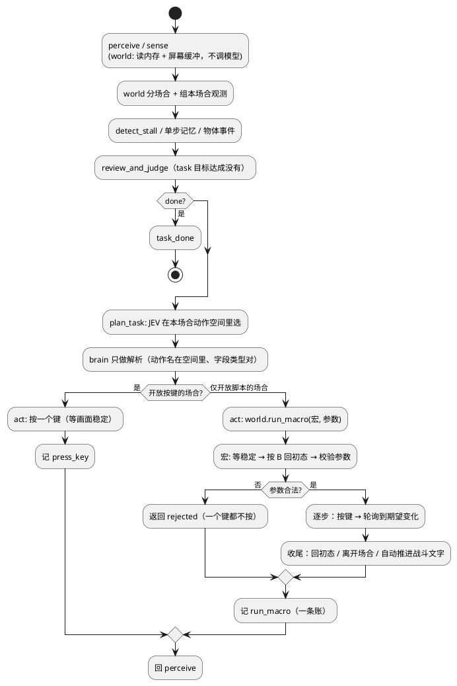
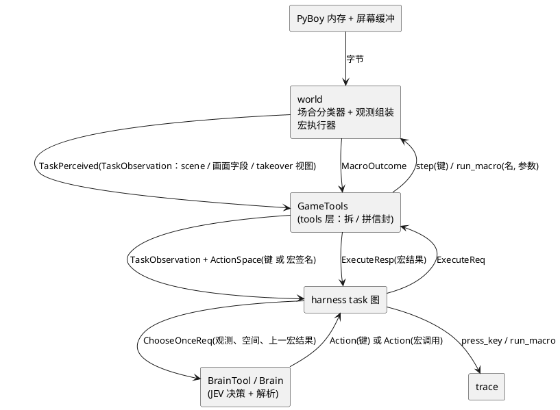

# spec —— task 层按场合感知；一切多级选择机械接管

> 流程位置：intent.md → **spec.md** → plan.md → PR → production
> 状态：**草案**（2026-09-26）；第十三节 1–4 已定，第 5 条是落地前的补测清单
> 上游：`intent.md` 第九节（1–10 条，已定）、`p0-findings.md` 第五节（按 B 回初态实测）、第六节（初态参数的内存实测）
> 原型：`evals/screen_reading/classify.py`（场合分类与 `at_start` 的规则原型，v2 数据集 1037 帧预标用它）
> 本文每个内存 / ROM 来源都标了**实测**与否；未实测的在第十三节列出。

---

## 一、范围

**做**：task 层（`ram_only`）每帧先分场合；开放按键的场合一键一决策，仅开放脚本的场合 JEV 出带参数的宏、world 执行到底；
宏的参数校验、回初态、逐步核对、战斗文字自动推进；宏调用一条账。

**不做**：episode 层视觉链路（除第三节第 4 条的字段统一）；skill library；放生；电梯 / 奖品兑换 / 售货机 / NPC 交换
（形状同 `shop_items`，遇到再加）。

## 二、task 链

每一圈仍是 task 图的五格（`harness/task/task_graph.py`：`perceive → review_and_judge → plan_task → act → perceive`），
**图不改形**；变的是格里装什么。

## 三、场合（`TaskScene`）

### 1. 词表

| 类 | 场合（`TaskScene`） | 主菜单（初态） |
|---|---|---|
| 常规 | `walk` / `dialog` / `battle`（战斗文字、单层 YES/NO、结算）/ `shop`（店里、买卖菜单没开）/ `pokemon_info` / `start_menu` / `title` / `transition` | — |
| 接管 | `naming` | 起名键盘 |
| 接管 | `shop_items` | `▶BUY / SELL / QUIT` |
| 接管 | `pc` | 选哪台 PC（`… 's PC` + `LOG OFF`） |
| 接管 | `bag`（野外） | 背包列表 |
| 接管 | `battle_menu` | `▶FIGHT / PKMN / ITEM / RUN` |
| 接管 | `battle_switch` | 战斗中的队伍选择列表，包括主动换人与倒下换人 |
| 接管 | `party`（野外） | 队伍列表 |
| 接管 | `learn_move` | "Delete an older move…" 的 YES/NO |

### 2. 判别

规则与判别顺序照搬原型 `evals/screen_reading/classify.py::classify`（v2 1037 帧人工核对后定稿）。要点：
- 屏幕缓冲特征为主，按**整词 / 固定位置**匹配，不做子串匹配；
- 旁证：`wIsInBattle` 0xD057、`wListPointer` 0xCF8B（= 0xD31D 为背包）、`wCurMapTileset` 0xD367（= 2 为 MART，
  **只核过常青市商店**）；
- 学新招按提示文案判（`trying to learn` / `can't learn more` / `than 4 moves` / `Delete an older` / `move to make room` / `Which move should` / `be forgotten` / `Abandon learning`），用 RARE CANDY 触发实测过。

### 3. 初态

`at_start` = 本场合主菜单画着 **且** 有实心 `▶` **且** 屏上没有任何空心 `▷`。
战斗行动菜单另要求完整FIGHT/PKMN/ITEM/RUN四项且光标在FIGHT；恢复流程在主菜单用方向键归位，子菜单按B退回。
只看三角不够：战斗的招式列表 / 背包 / 换人列表、PC 各级菜单整块盖住上一层，不留 `▷`（实测）。

**画面稳定**：判 `at_start` 前先等屏幕缓冲连续 `STABLE_POLLS` 次不变（每次间隔 `POLL_FRAMES` 帧）——游戏处理按键时会擦掉
`▶` 重画（v2 里十来帧实证），不等稳定会误判"不在初态"而多按一次 B 退出场合。两个常量是 world 私有物理量。

### 4. 落在哪里、叫什么

- 新增 `pokemon_agent/world/scene.py`：`classify(text, mem) -> TaskScene`、`at_start(text, scene) -> bool`，纯函数；
  原型迁入后测评改测它（第十一节）。
- **task 层与 episode 层是两种观测**：episode 层照旧 `Observation` / `Facts`（视觉链路，其中 `Facts.Scene` 是视觉给的场景）；
  task 层用新的 `TaskObservation`（新增 `world/interface/domain/task_observation.py`），它的场合字段就叫 `scene`，
  类型 `TaskScene`（`StrEnum`，新增在同目录）。两者只是重名，互不引用。

## 四、观测

### 0. `TaskObservation` 与取帧入口

- `WorldPort` 新增 `perceive_task() -> TaskPerceived`（不调模型、不会失败），取代 `perceive_once(ram_only=True)` 这一档；
  `perceive_once()` 只剩视觉档，给 episode 层。`pyboy_world.py::_ram_observe` 改为产出 `TaskObservation`。
- `TaskObservation` 字段：`step`、`done`、`place`、`status`、`scene`、开放按键的场合的画面字段（下一小节）、`takeover`（仅开放脚本的场合的视图）。
- 随之改用 `TaskObservation` 的 task 层消费方（plan 里逐个落）：`harness/sensing.py` 的 task 档、`harness/task/task_state.py`、
  `harness/task/perceive/detect_stall.py`、`store_object_semantic_memory/rules.py`、`FromHarnessToBrainToolChooseOnceReq`、
  `FromHarnessToGameToolExecuteReq`、`FromHarnessToGameToolGetActionSpaceReq`、`FromHarnessToGameToolPerceiveOnceResp`（task 档另立响应）、
  `schemas/memory/datastore/act_memory.py`（ActMemory 的前后帧）、`tools/trace/render.py`。

### 1. 开放按键的场合

与现在的 RAM 档内容相同（`pyboy_world.py::_ram_observe`），两处变化：
- **`walk_map` 与 `screen` 互斥**：`screen` 非空只给 `screen`，否则只给 `walk_map`；`where` / `neighbors` / `landmarks` 照给；
- `dialog_text` / `options` / `cursor` 照给（`walk` 场合为空）。

### 2. 仅开放脚本的场合

`TaskObservation.takeover: TakeoverView | None`，按 `scene` 区分的判别联合（新增 `world/interface/domain/takeover_view.py`）。
观测里不给 `screen` 以外的逐键信息（光标位置、翻页）——那是执行器的事。

| 视图 | 字段 | 来源 | 实测 |
|---|---|---|---|
| `NamingView` | 给谁起名、已输入的名字 | 屏幕标题（"YOUR NAME?" / "RIVAL's NAME?" / "NICKNAME?"）；`wStringBuffer` 0xCF4B | ✅ |
| `ShopItemsView` | 商品（名、单价）、金钱、背包（名、数量） | `wItemList` 0xCF7B + ROM `ItemNames` 0x472B / `ItemPrices` 0x4608；`wPlayerMoney` 0xD347（BCD）；背包 0xD31D | ✅ 商品表在 `▶BUY` 菜单出现时已写好 |
| `PcView` | PC 道具、背包、当前箱宝可梦（种类、昵称）、当前箱号 | 0xD53A；0xD31D；`wBoxCount` 0xDA80 / `wBoxSpecies` 0xDA81 / `wBoxMonNicks` 0xDE06；`wCurrentBoxNum` 0xD5A0 | ✅（箱只有当前箱） |
| `BagView` | 背包（名、数量）、队伍（昵称、HP） | `wNumBagItems` 0xD31D；`wPartyCount` 0xD163 / `wPartyMonNicks` 0xD2B5；HP 同下 | 背包、昵称 ✅；HP 未逐帧核 |
| `BattleMenuView` | 出场宝可梦招式与 PP、队伍（昵称、HP、招式）、背包 | `wBattleMonMoves` 0xD01C / `wBattleMonPP` 0xD02D（低 6 位）；`wPartyMon1Moves` 0xD173 / `wPartyMon1PP` 0xD188，每只 +44 | ✅ 与 FIGHT 列表、能力页一致 |
| `BattleSwitchView` | 队伍（昵称、HP、是否倒下） | 同上；HP `wPartyMon1HP` 0xD16C，每只 +44 | 昵称 ✅；HP 地址取自 pokered.sym，未逐帧核 |
| `PartyView` | 队伍（昵称、等级、HP、招式） | 同上 | ✅ |
| `LearnMoveView` | 谁在学、想学的招、现有四招 | 学招的是队伍第 `wWhichPokemon` 0xCF92 只；想学的招 `wMoveNum` 0xD0E0 | ✅（RARE CANDY 触发实测） |

名字表：招式 / 物种 / 道具的 id → 名字沿用 `experiment/observation_check/id_tables/*.json` 的内容，**搬进 world**（world 不 import experiment）。

## 五、动作

### 1. 动作空间

`ActionSpace` 新增 `macros: list[MacroSpec]`（新增 `world/interface/domain/macro_spec.py`）：宏名、参数名与类型、给 LLM 的说明。
- 开放按键的场合：`names` 照现在的 overlay 掩码（`tools/game_tools.py::_mask`），`macros` 为空；
- 仅开放脚本的场合：`names` 为空，`macros` 是本场合的宏（下表）。`ActionSpace` 现有的"`names` 非空"后置条件改为"`names` 与 `macros` 至少一个非空"。

| 场合 | 宏 |
|---|---|
| `naming` | `enter_name(name: str)` |
| `shop_items` | `buy(item: str, quantity: int)`、`sell(item: str, quantity: int)`、`quit()` |
| `pc` | `withdraw_item` / `deposit_item` / `toss_item(item: str, quantity: int)`、`withdraw_pokemon` / `deposit_pokemon(pokemon: str)`、`change_box(n: int)`、`log_off()` |
| `bag` | `use(item: str, pokemon: str = "")`、`toss(item: str, quantity: int)`、`close()` |
| `battle_menu` | `fight(move: str)`、`switch(pokemon: str)`、`use_item(item: str, pokemon: str = "")`、`run()` |
| `battle_switch` | `send_out(pokemon: str)` |
| `party` | `switch(a: str, b: str)`、`field_move(pokemon: str, move: str)`（FLY 要再选目的地，暂不支持）、`stats(pokemon: str)`、`close()` |
| `learn_move` | `forget(move: str)`、`skip()` |

`quit` / `log_off` / `close`：离开场合也是宏（按 B 到初态后再按一下 B / 选退出项），JEV 在仅开放脚本的场合不直接按键。

### 2. 动作形状（brain 侧）

`brain/interface/domain/action.py::Action` 新增 `macro: MacroCall | None`（`MacroCall(name: str, args: dict[str, str | int])`，
新增在同目录）；`sequence` 与 `macro` 二者恰好一个非空。模型输出 `{"action": "buy", "item": "POKé BALL", "quantity": 5}`。

`Brain._parse` 只做解析：动作名在本次空间（键或宏名）里、参数齐全且类型对；失败抛现有的 `ParseFailure` / `IllegalAction`，
走现有重试。**不做语义校验**（intent 第九节第 7 条）。

## 六、宏执行器（world）

### 1. 放在 world

宏是"这个游戏怎么操作"的知识，要连续读内存、按键、轮询，是跨步骤编排——按范式不进 tools 层。放 `pokemon_agent/world/macros/`：
- `engine.py`：通用骨架（下一小节）；
- 每个场合一个文件（`shop.py`、`pc.py`、`bag.py`、`battle.py`、`party.py`、`naming.py`、`learn_move.py`），每个宏只写**前提校验 + 步骤表 + 收尾**；
- `WorldPort` 新增 `run_macro(name: str, args: dict[str, str | int]) -> MacroOutcome`；`GameTools.execute` 按 `Action` 是键还是宏分派，
  把 `MacroOutcome` 翻成 harness 认识的结果（第七节）。

### 2. 通用骨架（`engine.run`）

1. **回初态**：等画面稳定 → `at_start` 真则进 2；场合已不是本宏的场合 → 结束（`left_scene`）；否则按 B → 回到本步开头。上限 `REWIND_LIMIT` 次，超了结束（`aborted`）。
2. **校验**：按**此刻**内存查前提（第四小节）；不合法 → 结束（`rejected`），一个键都没按过（回初态按的 B 除外，记在明细里）。
3. **执行**：逐步"按键 → 轮询到期望变化"。期望变化是内存或屏幕的具体条件（数量框出现、`wItemQuantity` = n、钱少了 n×单价……）；
   每步最多等 `STEP_TIMEOUT_FRAMES`，超时 → 按 B 回初态 → 结束（`aborted`，写明停在哪一步）。
4. **收尾**：
   - 商店、PC、背包、队伍：按 B 回到初态（`done`）；
   - `battle_menu` / `battle_switch` / `learn_move`：出招等之后**自动推进战斗文字**——只在屏上出现 `▼`（游戏在等按键）、
     或画面静止满 `QUIET_PRESS_FRAMES` 帧时按 A（文字自己在走时按早了会落在紧接着出现的选单上）；
     遇到任意 `▶`（下一个选单、单层 YES/NO 如 "Use next POKéMON?"、捕获后的起名询问）、或战斗标志清零、或达到 `ADVANCE_LIMIT`，停（`done`）。
     **遇到 `▶` 必须停**：按 A 会替 JEV 选掉单层 YES/NO。停在战斗选单的子层时按 B 退回行动菜单。
   - `naming`：START 提交后等画面离开键盘（`done`）；
   - `stats`：停在能力页（交给开放按键的场合 `pokemon_info`）。

`STABLE_POLLS` / `POLL_FRAMES` / `REWIND_LIMIT` / `STEP_TIMEOUT_FRAMES` / `ADVANCE_LIMIT` / `QUIET_PRESS_FRAMES` 等是 world 私有物理量，放 `macros/engine.py`，不进全局 config。

### 3. 列表导航

移光标用 `wCurrentMenuItem` 0xCC26 + `wListScrollOffset` 0xCC36 定位（✅ 商店购买流实测），目标项下标从本场合视图的列表里查；
数量用 `wItemQuantity` 0xCF96（上限 `wMaxItemQuantity` 0xCF97）逐次 up / down 到位（✅）；起名键盘用 `wMenuCursorLocation` 0xCC30
算行列（✅），先把已输入的字按 B 删空（✅）、`wAlphabetCase` 0xCEEB 非 0 时按 SELECT 切回大写（✅）。

### 4. 各宏的前提与成功判据

| 宏 | 前提（不满足即 `rejected`） | 成功判据 |
|---|---|---|
| `buy` | 商品在 `wItemList`；1 ≤ n ≤ 99；钱 ≥ n×单价；背包有空位或已有该物 | 钱减 n×单价，背包该物 +n |
| `sell` | 背包有该物且数量 ≥ n；该物可卖（有价格、非重要道具） | 钱加 n×单价/2，背包该物 −n |
| `withdraw_item` / `deposit_item` / `toss_item` | 源处有该物且数量够；目标有空位；重要道具不弹数量框 | 两处数量相应变化 |
| `withdraw_pokemon` / `deposit_pokemon` | 源处有该宝可梦；队伍 ≥ 2 才能存；队伍 < 6 才能取 | 队伍数、当前箱数相应变化 |
| `change_box` | 1 ≤ n ≤ 12 | `wCurrentBoxNum` = n−1 |
| `use` / `use_item` | 背包有该物；需要对象时对象在队伍里 | 背包该物 −1（招式学习器等例外按道具定） |
| `toss` | 背包有该物且数量 ≥ n；非重要道具 | 背包该物 −n |
| `fight` | 招式是出场宝可梦的且 PP > 0 | 离开行动菜单（招式已选定） |
| `switch`（战斗）/ `send_out` | 目标在队伍里、没倒下、不是出场的 | 出场宝可梦变为目标 |
| `run` | —（能不能逃是游戏判） | 离开行动菜单 |
| `switch`（野外） | 两只都在队伍里且不同 | 队伍顺序对调 |
| `field_move` | 宝可梦会这招、该招可在野外用 | 离开队伍列表 |
| `enter_name` | 1 ≤ 长度 ≤ 上限（主角 / 对手 7，昵称 10）；只含大写字母 | `wStringBuffer` 等于名字，画面离开键盘 |
| `forget` / `skip` | `forget` 的招式在现有四招里 | 画面离开学新招提示 |

## 七、结果与错误词汇

- world 侧：`MacroOutcome`（新增 `world/interface/domain/macro_outcome.py`）
  - `status`：`done` / `rejected` / `aborted` / `left_scene`；
  - `reason_code`：`rejected` 的闭集（`unknown_item`、`not_enough_money`、`bag_full`、`quantity_out_of_range`、`no_pp`、`not_in_party`、
    `fainted`、`party_too_small`、`party_full`、`key_item`、`invalid_name` …），`aborted` 的闭集（`rewind_limit`、`step_timeout`、`unexpected_screen`）；
  - `reason`：一句人话；`summary`：一行状态变化（"钱 3000→2000，POKé BALL +5"）；`steps: list[MacroStep]`（按键、等待帧数、期望、实际、是否通过）。
- `rejected` / `aborted` 是**预期内结果**，作为返回值，不是异常；宏内部"按了这一步应出现数量框"这类是 `assert` 契约。
- harness 侧：`FromHarnessToGameToolExecuteResp`（新增；现在 `execute` 返回 `None`）带宏结果；键动作时为空。
- 下一轮 `FromHarnessToBrainToolChooseOnceReq` 新增 `last_macro: str`（上一宏的结果与原因一句话），由 prompt 渲染在观测之后。

## 八、harness 改动

- `act`：键 → 现状；宏 → 一次 `execute`，记 `run_macro` 账（第十节）。`step + 1`（一个宏算一次决策，见第十三节第 3 条）。
- `perceive` 各单元：
  - `detect_stall`：宏按结果比——`rejected` 的宏不论参数视同同一个无效动作计入停摆，其余带上结果那一句（战斗里同一招连出、HP 在变不算停摆）；
  - `store_step_episode_memory`：一次宏写一条 ActMemory，动作写宏的 `describe()`（`buy(POKé BALL, 5)`），结果写 `summary` 或拒绝原因；
  - `store_object_semantic_memory/rules.py`：对话闸门 `press.after.perceived` 改为"这一帧的文字读过"（task 层解码、episode 层视觉）——现在 task 层的对话事件一条都记不下来。
- `review_and_judge`：不变；宏是原子的，跑完才判（intent 第九节第 9 条）。

## 九、brain 与 prompt

- `tools/prompts/decide_action.py` 按场合组 prompt：开放按键的场合照现在；仅开放脚本的场合渲染本场合视图与宏签名、"只输出一个宏调用"；
- "屏幕怎么读"（`▷` 是上一层、`-` 是空招式位、字面听屏幕）抽成一段共用片段，决策与判定两个模板都引用；
- 宏签名的说明文字来自 `MacroSpec`（world 定义），prompt 模板只写怎么选，不重复签名（"同一信息不两处传"）。

## 十、trace

- 新增 `TraceKind.RUN_MACRO`（`schemas/harness/domain/trace_kind.py`），`meta` 同 `press_key`（`source="act"`、episode / task / step）。正文三部分：
  1. 调用与结果：`scene`、`macro`、`args`、`status`、`reason_code`、`reason`；
  2. `summary`；
  3. `steps`（每步按键、等待帧数、期望、实际、通过与否）——**每次都记**。
  标量转字符串、布尔小写，`args` / `steps` 直接放对象（范式"存在反函数"）。
- `docs/spec/DATAFLOW.md` 事件总表加一行。

## 十一、测评

- `evals/screen_reading/`：`classify` / `at_start` 改测 world 的实现（`world/scene.py`），原型删除；数据集 v2 人工核对后冻结。
- 新增 `evals/macros/`：从存档出发调宏，核对状态变化、结果码、是否回到初态；每个宏至少"成功 / 被拒 / 从中途步骤开跑"三例。
- 新增 `evals/takeover_views/`：仅开放脚本的场合的初态帧，逐帧核对视图字段（商品表、招式与 PP、PC 箱）与屏幕一致。
- 以上都是测评，不是单元测试；单元测试按范式另问。

## 十二、分期（plan 的切法）

1. 场合分类器 + `at_start` 迁入 world；`TaskObservation` 与 `perceive_task()`，task 层消费方换型；`walk_map` / `screen` 互斥；读屏测评改测 world。
2. 宏骨架（`engine`）+ `MacroOutcome` + `run_macro` 账；先落 `shop_items` 三个宏与 `naming`。
3. 战斗：`battle_menu` / `battle_switch` 与自动推进。
4. `pc`、`bag`、`party`；`learn_move`（先补一份能触发学新招的存档实测）。
5. prompt 分场合 + 共用读屏片段；对象事件闸门修正。

每期落地都跑读屏测评与宏测评，写一条 CHANGELOG。

## 十三、要拍板的

1. ✅ **两层两种观测**：task 层 `TaskObservation.scene`（`TaskScene`），episode 层照旧 `Observation` / `Facts`；只是重名（第三节第 4 条、第四节第 0 小节）。
2. ✅ **宏执行器放 world**，`GameTools` 只分派与翻译（第六节第 1 小节）。
3. ✅ **task 预算改成决策预算**：一个宏记 1；宏内部按键由 `REWIND_LIMIT` / `STEP_TIMEOUT_FRAMES` / `ADVANCE_LIMIT` 兜住。
4. ✅ **`run_macro` 一条账**（第十节）。
5. **未实测**：除常青市外其它商店的图块集；飞天选目的地（`field_move` 暂不支持 FLY）；`use` 招式学习器 / 进化石的画面流（招式学习器宏里拒掉，进化石按通用流程推话）；训练家对战。
